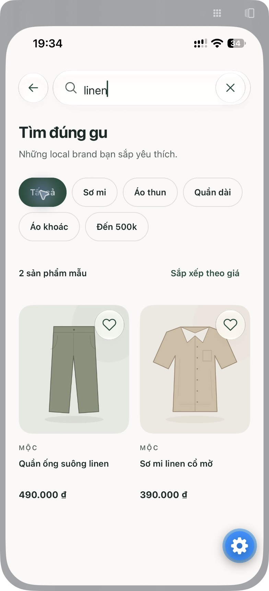

# Search trên iPhone — 10/11/2026

## Thay đổi

- Home đặt `SearchEntry` trước hàng địa điểm và nội dung giới thiệu. Chữ và icon dùng chung typography/spacing với `SearchInput`, chiều cao tối thiểu 52 pt.
- Search chuyển từ tab sang route `/search` trong root native Stack, dùng chuyển cảnh mặc định của hệ thống. Chạm thanh trên Home mở Search và focus input; liên kết danh mục vẫn giữ bộ lọc.
- Thanh tab native còn Khám phá, Cửa hàng, Đã lưu và Cá nhân.
- Không thêm dependency.

## Môi trường và kết quả iOS

Expo Go, SDK 58; iPhone 13 Pro qua iPhone Mirroring. Ảnh cửa sổ Mirroring 784 × 1720 px, không phải độ phân giải màn hình gốc. Chưa xác nhận số phiên bản iOS từ Settings. Đã full Reload Expo Go sau thay đổi navigator.

| Thao tác                        | Kết quả quan sát                                                            |
| ------------------------------- | --------------------------------------------------------------------------- |
| Mở Home                         | Search nằm trên cùng, chữ tiếng Việt không bị cắt; bốn tab, không có Search |
| Chạm Search trên Home           | Mở màn Search qua native Stack; input nhận focus, có caret                  |
| Nhập `linen`                    | Hai sản phẩm mẫu                                                            |
| Mở danh mục Sơ mi từ Home       | Search nhận bộ lọc Sơ mi, hiển thị hai sản phẩm                             |
| Nhập `linen` khi lọc Sơ mi      | Một sản phẩm; chọn Tất cả trả về hai sản phẩm                               |
| Xóa từ khóa bằng nút ×          | Input rỗng; danh sách khôi phục và giữ bộ lọc hiện tại                      |
| Từ khóa không khớp              | Hiển thị trạng thái rỗng                                                    |
| Chạm nút quay lại               | Trở về Home, thanh tìm kiếm và bốn tab vẫn hiện đúng                        |
| Kéo vùng chọn Khám phá ↔ Đã lưu | Chuyển màn và vùng chọn native thành công cả hai chiều                      |

Nút bánh răng xanh trong ảnh là công cụ nổi của Expo Go. Đã kéo nút này ra khỏi vùng xóa input để kiểm tra thao tác.

## Kiểm tra mã nguồn

- `npm run check`: đạt typecheck, lint, UI guard, 8 tests và kiểm tra định dạng.
- Export web, iOS và Android: thành công sau thay đổi navigation/shared input. Đây là kiểm tra bundle; không phải kiểm thử giao diện Android/web.
- `git diff --check`: đạt.

Theo yêu cầu mới nhất, kiểm thử tương tác tập trung vào iOS; không tiếp tục kiểm thử giao diện web/Android và không cài simulator.

Chưa xác minh bàn phím phần mềm (Mirroring dùng bàn phím Mac), vuốt cạnh để quay lại, Dynamic Type, Reduce Motion/Transparency hoặc hiệu năng bản release. Không đo FPS; ảnh tĩnh không chứng minh độ mượt của animation.

## File liên quan

- `src/components/ui/search-input.tsx`, `src/theme/index.ts`: thanh mở Search và typography/input dùng chung.
- `src/features/home/home-screen.tsx`, `src/features/search/search-screen.tsx`: vị trí thanh tìm kiếm, focus, nút quay lại.
- `src/app/search.tsx`, `src/app/_layout.tsx`: route root Stack; bỏ `src/app/(tabs)/search.tsx`.
- `src/components/navigation/app-tabs.tsx`, `src/components/navigation/app-tabs.web.tsx`: bỏ mục Search.
- `docs/design-system.md`, `docs/apple-native-ui.md`, `docs/tasks/03-search-product.md`: cập nhật quy ước route/component.
